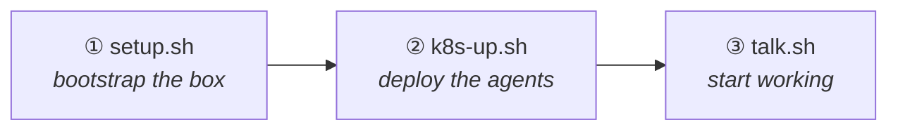
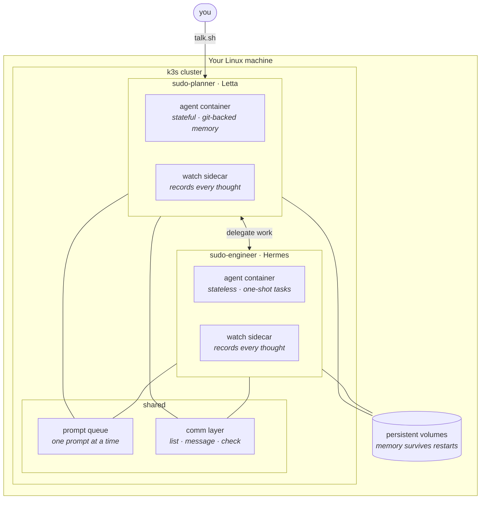
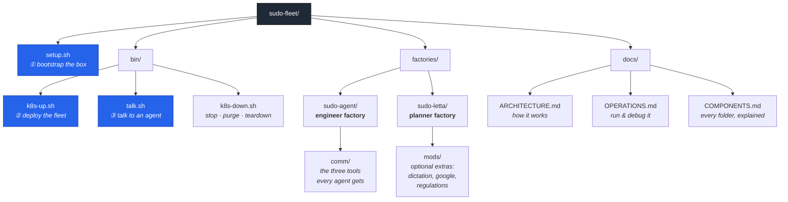

<div align="center">

# sudo-fleet

**A fleet of AI agents on one Linux box — planners that think, engineers that build, and a mesh that lets them talk.**



</div>

---

## Quick start

Three commands. That is the whole install.

### ① Clone and bootstrap

Installs Docker and k3s, builds the agent images, and writes your config.

```bash
git clone https://github.com/salmonhealer772/sudo-fleet.git && cd sudo-fleet && bash setup.sh
```

<sub>Asks for one LLM API key and an optional web-search key. Takes a few minutes — it is compiling images.</sub>

### ② Put the fleet up

Deploys a Letta planner and a Hermes engineer, with their storage and network wired.

```bash
cd bin && bash k8s-up.sh
```

<sub>Override the names if you like: <code>PLANNER_NAME=boss ENGINEER_NAME=worker bash k8s-up.sh</code></sub>

### ③ Talk to your agent

Opens a live Letta Code session in your terminal. This is where you work.

```bash
sudo bash bin/talk.sh --planner
```

<sub>Run from the repo root. Any agent name works: <code>--engineer</code>, or whatever you deployed.</sub>

That is it. You are in front of a working agent with persistent memory, tools, and a teammate it can delegate to.

---

## What you just built



<details>
<summary><b>The two kinds of agent</b></summary>

<br/>

| | **Planner** (Letta) | **Engineer** (Hermes) |
|---|---|---|
| Memory | Persistent, git-backed, survives everything | Fresh each task; state lives on its volume |
| Best at | Deciding, planning, delegating, remembering | Executing one job well and reporting back |
| You talk to it | Yes — this is your interface | Yes, but usually the planner does |
| Needs | A conversation | A task |

Planners delegate to engineers. Engineers do the work and report. Both can message any sibling in the fleet.

</details>

---

## How the repo is laid out



<details>
<summary><b>Every folder, one line each</b></summary>

<br/>

| Path | What it is |
|---|---|
| `setup.sh` | Command ① — installs Docker + k3s, builds images, writes `.env` |
| `bin/k8s-up.sh` | Command ② — deploys the planner and engineer |
| `bin/talk.sh` | Command ③ — opens a session with any agent |
| `bin/k8s-down.sh` | Stops agents; can also purge volumes or remove k3s |
| `bin/k8s-auto-up.sh` | Re-applies everything after a reboot |
| `bin/verify-change.sh` | Read-only health check: runtime, config, auth, exposure |
| `factories/sudo-agent/` | The Hermes engineer factory — image, deploy script, MCP door, queue, comm tools |
| `factories/sudo-letta/` | The Letta planner factory — image, deploy script, mods, seeded skills |
| `factories/sudo-agent/comm/` | The comm layer shared by both kinds: tools, skills, contracts, tests |
| `factories/mac/` | Optional Mac helpers (keyboard, RGB, HID capture) — not needed on a server |
| `docs/` | The documentation set — see the index below |
| `deployments/` | Saved agent identities. Empty by default; see [`docs/COMPONENTS.md`](docs/COMPONENTS.md) |

</details>

---

## Documentation

Start with the first two. The rest is reference.

| | |
|---|---|
| **[Architecture](docs/ARCHITECTURE.md)** | How the pieces fit: factories, ports, queue, comm, identity |
| **[Operations](docs/OPERATIONS.md)** | Deploy, inspect, debug, recover — with a failure table |
| [Repository vs. instance](docs/REPOSITORY-VS-INSTANCE.md) | What belongs in this repo and what never does |
| [Comm layer](docs/COMM-LAYER.md) | How agents find and message each other |
| [Components](docs/COMPONENTS.md) | Every directory, and what it is for |
| [Known issues](docs/KNOWN-ISSUES.md) | Open defects, with evidence |
| [Spec](docs/SPEC.md) | The original design contract |

<details>
<summary><b>Security posture</b></summary>

<br/>

Agent containers run privileged with the Docker socket mounted, because the comm layer reaches the cluster through it. That is a path from the agent container to the host kernel — treat a host running this as a host the agents can reach, not as a sandbox.

Some values reach a Deployment as literal environment variables rather than Secret references. [`docs/ARCHITECTURE.md`](docs/ARCHITECTURE.md) says which. This repository is public: never commit a key, a password, a token, or a real agent's identity.

</details>

---

<div align="center">
<sub>

**Working on this repository?** Start with [`docs/ARCHITECTURE.md`](docs/ARCHITECTURE.md).<br/>
Changing the pod spec needs `k8s-up.sh` again — a rollout restart will not pick up env or volume changes.<br/>
Then [`docs/CHANGE-PROTOCOL.md`](docs/CHANGE-PROTOCOL.md) for what to verify before calling it done.

</sub>
</div>
